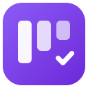
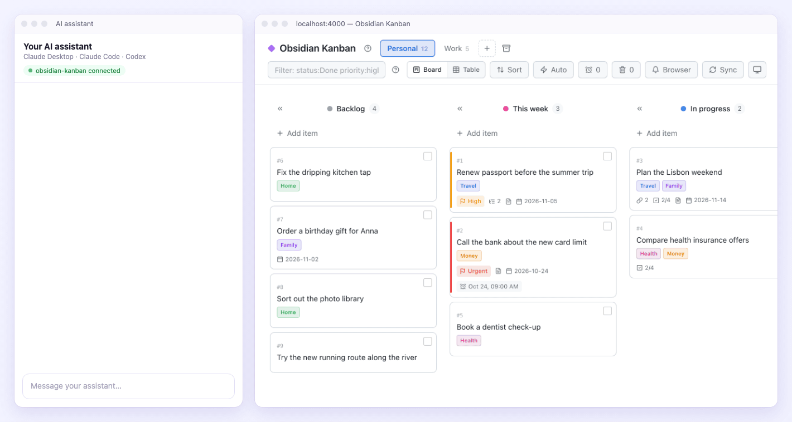
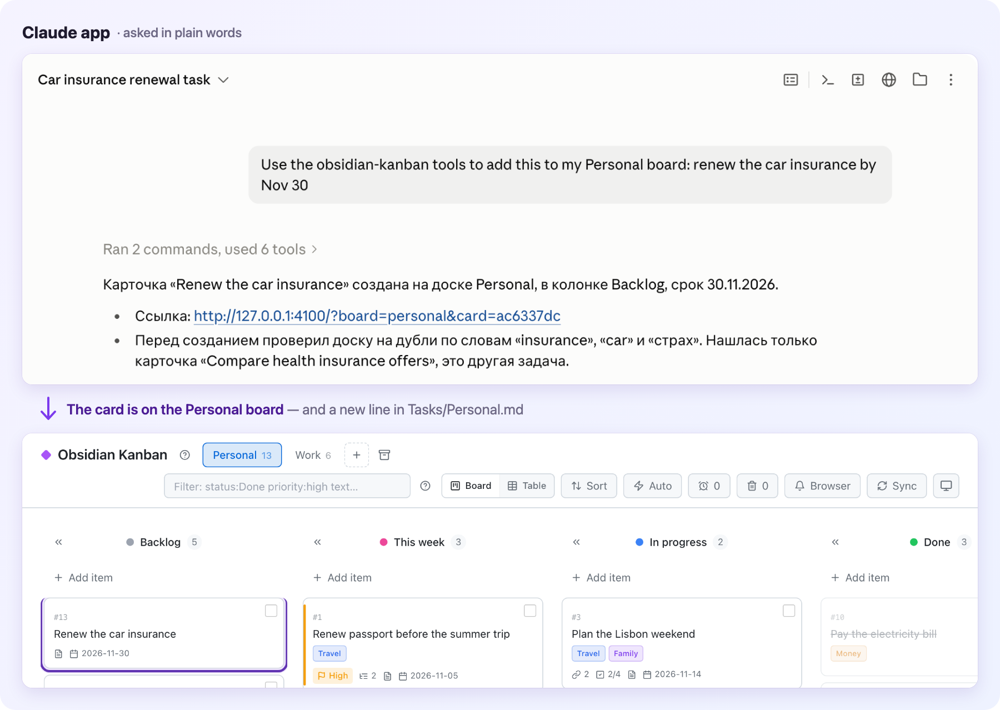
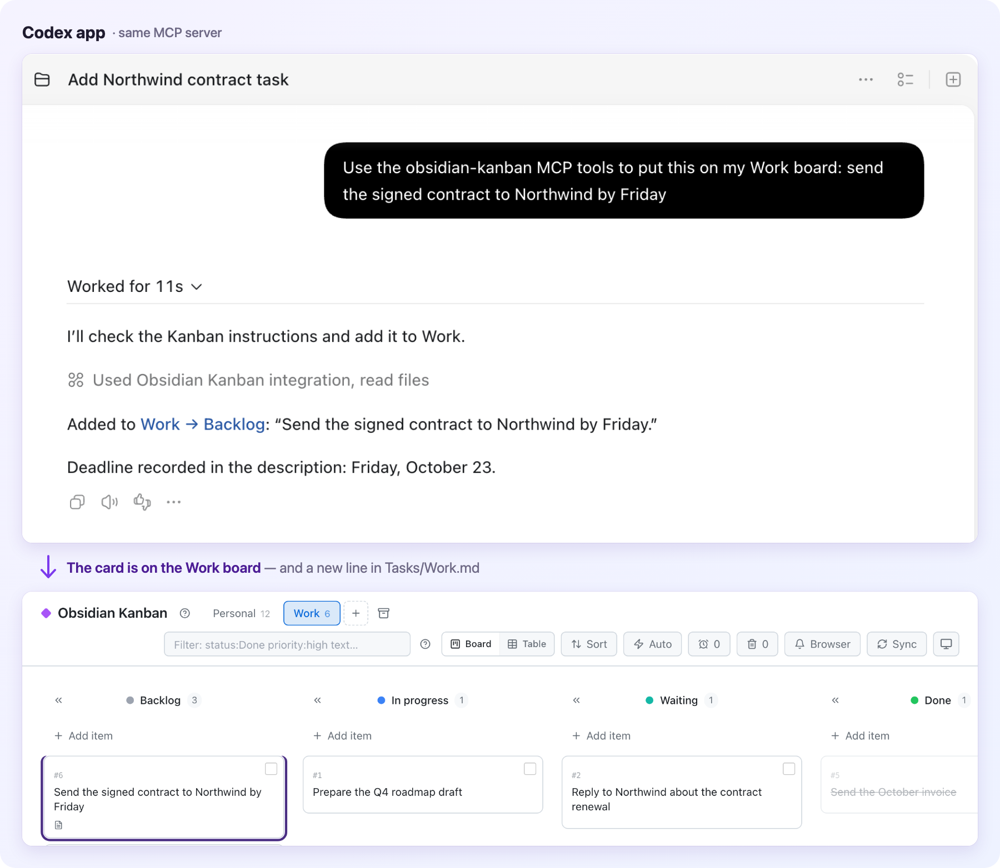
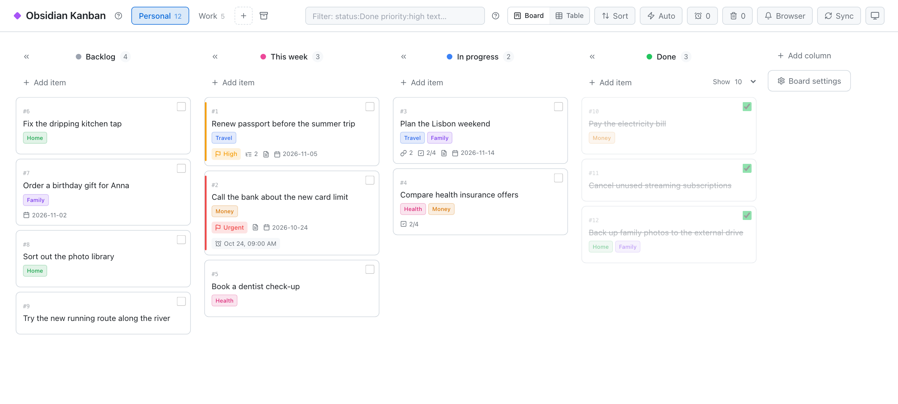
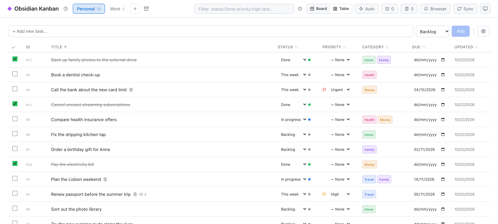
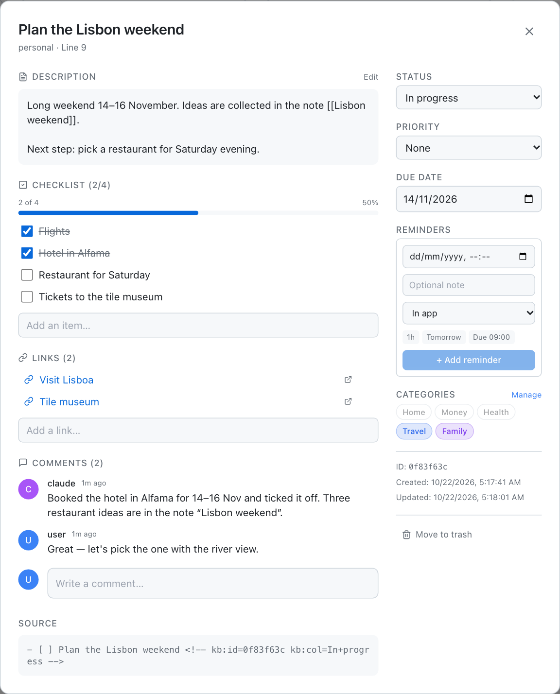
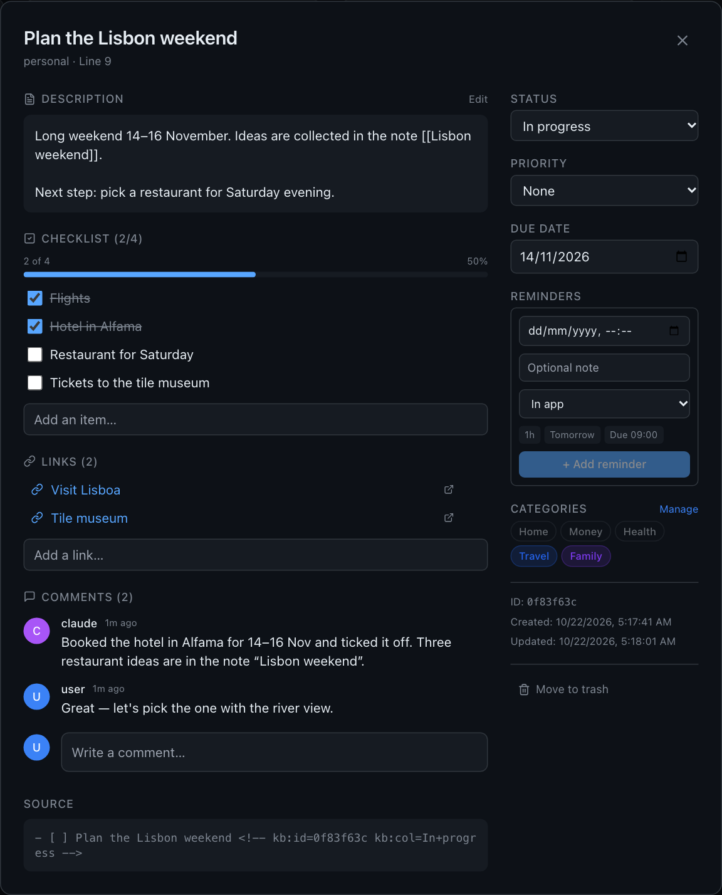
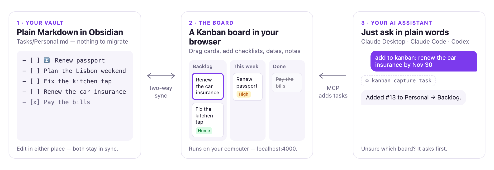

<div align="center">



# Obsidian Kanban

**Save tasks from Claude and Codex to a visual Kanban board — kept as plain Markdown in your Obsidian vault.**

Tell the Claude app or the Codex app *“add to kanban: renew the car insurance by Nov 30”* — the card appears on your board<br>
and as a `- [ ]` line in your notes. Drag it in the browser, tick it in Obsidian: both stay in sync.

[](#how-it-works)
[](#connect-your-ai-assistant)
[](#connect-your-ai-assistant)
[](docs/desktop-mcp.md)
[](LICENSE)

[From Claude & Codex](#save-tasks-from-claude-and-codex) · [Quick start](#quick-start) · [Connect your AI](#connect-your-ai-assistant) · [Screenshots](#a-closer-look) · [How it works](#how-it-works) · [FAQ](#faq) · [Docs](#documentation)



<sub>Demo data. The chat panel is drawn; the board and the new card are real — the card also became line 19 of <code>Tasks/Personal.md</code>. Real screenshots of the Claude and Codex apps are <a href="#save-tasks-from-claude-and-codex">just below</a>.</sub>

</div>

## Save tasks from Claude and Codex

Ask your AI app in plain words. Moments later the task is a card on your board and a `- [ ]` line in your Obsidian note — no copying, no switching apps. Both apps reach the board through the MCP server that comes with it ([setup](#connect-your-ai-assistant)).





<sub>Real screenshots of the Claude desktop app (Claude Code in its Code tab; it answered in its user's language, Russian) and the Codex app, both connected to a demo board. The titles, the arrows and the purple outline around each new card were added on top.</sub>

## Why Obsidian Kanban

- 📝 **Your tasks stay plain Markdown.** Cards are ordinary `- [ ]` lines in your Obsidian notes. No new format, no account, nothing to import or export.
- 👀 **See everything at a glance.** Columns, priorities, colors, due dates, checklists and comments — a board instead of a long list.
- 🤖 **Your AI apps keep the board up to date.** Ask the Claude app, Claude Code or the Codex app to add a task, move it, comment on it or close it. When it is unclear which board you mean, the assistant asks one short question instead of guessing.
- 🏠 **Runs on your own computer.** The board is a small web app on `localhost`. Your tasks do not leave your machine unless you decide to publish the board.

## A closer look

<table>
  <tr>
    <td width="50%"></td>
    <td width="50%"></td>
  </tr>
  <tr>
    <td><b>Board.</b> Drag cards between columns; tick a card to move it to Done. Categories, priorities, due dates and reminders at a glance.</td>
    <td><b>Table.</b> A spreadsheet view with inline editing, sorting and filters like <code>status:Done priority:high</code>.</td>
  </tr>
  <tr>
    <td></td>
    <td></td>
  </tr>
  <tr>
    <td><b>Card details.</b> Description, checklist with progress, links, comments (your assistant can leave them too), reminders — and the Markdown line the card lives on.</td>
    <td><b>Dark mode.</b> Follows your system theme, or pick one in the toolbar.</td>
  </tr>
</table>

## Quick start

Pick the way that suits you. Each ends with the board open at **http://localhost:4000**.

### 1. Let Claude Code install it (Mac, ~10 minutes)

Open [Claude Code](https://code.claude.com/docs) on your Mac and paste:

```text
Install Obsidian Kanban on this Mac by following
https://github.com/sergi039/obsidian-kanban-app/blob/main/docs/personal-install.md
```

Claude asks which Obsidian vault to use and does the rest with one script: no administrator password, everything stays in your home folder. Afterwards, in a new Claude Code session, type *“add to kanban: check the install”* and watch the card appear. Details: [docs/personal-install.md](docs/personal-install.md) (Apple Silicon Mac).

### 2. Run it yourself (any computer with Node.js)

You need [Node.js 22](https://nodejs.org/) and [pnpm](https://pnpm.io/).

```bash
git clone https://github.com/sergi039/obsidian-kanban-app.git
cd obsidian-kanban-app
pnpm install
```

Create `config.boards.json` next to `package.json` and point it at your vault and a task file:

```json
{
  "vaultRoot": "/path/to/your/Obsidian/Vault",
  "boards": [
    { "id": "personal", "name": "Personal", "file": "Tasks/Personal.md",
      "columns": ["Backlog", "This week", "In progress", "Done"] }
  ],
  "defaultColumns": ["Backlog", "In progress", "Done"]
}
```

```bash
pnpm build
SERVE_STATIC=1 pnpm --filter @kanban/api start
```

The task file is any note with checkboxes:

```markdown
- [ ] ⏫ Renew passport before the summer trip
    - Book an appointment online
- [ ] Plan the Lisbon weekend
- [x] Pay the electricity bill
```

`⏫` marks a high priority, indented lines become sub-items, `- [x]` is done.

### 3. Docker

Put the same `config.boards.json` into a `config/` folder next to `docker-compose.yml`, then run `VAULT_PATH=/path/to/vault docker compose up -d` and open `http://localhost:4000`. Details: [reference](docs/reference.md#docker).

## Connect your AI assistant

The app includes an **MCP server** — the standard way AI apps use tools. With it your assistant can list your boards, find cards, add a task, add to a card, move or close it, comment on it and follow up an email. It talks only to your local board, never directly to your files.

**After the [one-script install](#1-let-claude-code-install-it-mac-10-minutes)** there is nothing to do: it registers the server for Claude Code, and for Codex when Codex is on the Mac.

**Otherwise, step 1.** Build the MCP server (the board must be running, see above):

```bash
pnpm --filter @kanban/mcp build
```

**Step 2.** Add it to your assistant (replace the path):

| Assistant | Status | How |
|---|---|---|
| **Claude Code** (terminal and the Code tab of the Claude app) | ✅ Local MCP | one command — see below |
| **OpenAI Codex** (app, CLI, IDE extension) | ✅ Local MCP | one command — see below |
| **Claude Desktop** (chat) | ✅ Local MCP | Settings → Developer → Edit Config — see below |
| **ChatGPT chat**, **claude.ai** in the browser or on the phone | 🚧 Not yet | they need a remote HTTPS MCP server with sign-in, which this project does not ship ([why](docs/decisions/0003-agent-access-through-local-mcp.md)) |

<details>
<summary><b>Claude Code</b></summary>

```bash
claude mcp add --scope user obsidian-kanban -e KANBAN_API_URL=http://127.0.0.1:4000 \
  -- node /path/to/obsidian-kanban-app/apps/mcp/dist/server.js
```

Check with `/mcp` in a new session.
</details>

<details>
<summary><b>OpenAI Codex</b></summary>

```bash
codex mcp add obsidian-kanban --env KANBAN_API_URL=http://127.0.0.1:4000 \
  -- node /path/to/obsidian-kanban-app/apps/mcp/dist/server.js
```

The Codex app, the CLI and the IDE extension read the same `~/.codex/config.toml`. Check with `/mcp` in Codex. Codex uses the tools without asking, except rewriting a card's whole description, which it asks you to approve.
</details>

<details>
<summary><b>Claude Desktop</b></summary>

Settings → Developer → Edit Config opens `claude_desktop_config.json`. Add:

```json
{
  "mcpServers": {
    "obsidian-kanban": {
      "command": "/absolute/path/to/node",
      "args": ["/path/to/obsidian-kanban-app/apps/mcp/dist/server.js"],
      "env": { "KANBAN_API_URL": "http://127.0.0.1:4000" }
    }
  }
}
```

The app may not see your shell's `PATH`, so give `node` by its full path (`which node`). Quit Claude Desktop completely and open it again.
</details>

If the board runs with `API_TOKEN`, add `KANBAN_API_TOKEN` with the same value. Card links in the answers open `KANBAN_APP_URL` when you set it (your board's public address), else `KANBAN_API_URL`.

**Step 3.** Ask in plain words:

| You say | What happens |
|---|---|
| *“add to kanban: renew the car insurance by Nov 30”* | A card in the first column of the right board. Several boards fit? The assistant asks which one. |
| *“put ‘prepare the Q4 roadmap’ on my Work board”* | The card goes straight to the board you named. |
| *“make a task from this email”* (an assistant that can read your mail) | The card links back to the email; the same thread never becomes a second card. |
| *“which boards do I have?”* | Boards, columns, categories and priorities. |

More: [docs/desktop-mcp.md](docs/desktop-mcp.md) — the tools, tasks from email, a board on another Mac, the safety model.

## How it works

<picture>
  <source media="(prefers-color-scheme: dark)" srcset="docs/assets/how-it-works-dark.png">
  
</picture>

- **Obsidian stays the source.** Each task line in your note is a card; ticking `[x]` in Obsidian moves it to Done, and dragging it back on the board unticks it.
- **Changes show up in under a second.** A file watcher picks up edits in Obsidian; edits on the board are written back to the file. Every open tab updates live.
- **Nothing gets lost.** The card's column is kept in an invisible comment on its line (`<!-- kb:id=… kb:col=… -->`, an HTML comment that Obsidian's reading view hides), so the board survives even if its database is deleted.
- **Extras live next to the app.** Checklists, comments, categories and reminders are stored in a local SQLite file, not in your notes.

## Features

- **Views** — board with drag & drop, table with inline editing, saved views, filters and sorting
- **Cards** — `#1`-style IDs, descriptions, checklists, links, comments, due dates, custom fields
- **Organize** — priorities, colored categories, collapsible columns, bulk move and close, trash with restore
- **Remind** — in-app and browser reminders; macOS notifications, Calendar and Mail through a small local agent ([reminders](docs/reminders.md))
- **Calendars** — Outlook and Google events linked to a card show up on it
- **Automate** — rules such as “when a card moves to Done, set a field”
- **Stay safe** — runs on `localhost`, refuses requests from other web pages, backs up its config and database on every start

<sub>The full list is in the [reference](docs/reference.md#full-feature-list).</sub>

## FAQ

<details>
<summary><b>Is this an Obsidian plugin?</b></summary>

No. It is a small web app that runs next to Obsidian and reads and writes the same Markdown files. Obsidian does not even need to be open.
</details>

<details>
<summary><b>How is it different from the Kanban plugin for Obsidian?</b></summary>

The plugin draws a board inside Obsidian from a file in its own board format. Obsidian Kanban keeps your ordinary checklists as they are, opens them as a board in any browser, adds a table view, reminders and comments, and lets AI assistants add tasks through MCP.
</details>

<details>
<summary><b>Do I need Obsidian at all?</b></summary>

No — any folder of Markdown files works. Obsidian is simply the nicest place to edit them.
</details>

<details>
<summary><b>Where are my tasks stored? Does anything go to the cloud?</b></summary>

Tasks stay in your Markdown files; card extras stay in a SQLite file inside the app folder. The app talks to the internet only for what you turn on yourself, such as reading your Outlook or Google calendar. Your AI assistant sees what you ask it to add, the same as any chat.
</details>

<details>
<summary><b>Can I use it on my phone?</b></summary>

The board is a web page, so you can publish it behind a sign-in (the author uses Cloudflare Access — see the [reference](docs/reference.md#public-address-cloudflare-access)). Tasks edited in Obsidian on your phone reach the board through whatever already syncs your vault.
</details>

<details>
<summary><b>Does it work with ChatGPT?</b></summary>

The Codex part of OpenAI's apps — yes, through the same local MCP server. Regular ChatGPT chat can only use MCP servers on a public HTTPS address, which this project does not provide yet.
</details>

## Documentation

| Guide | What is inside |
|---|---|
| [Personal install](docs/personal-install.md) | The one-script Mac install, daily use, update, uninstall |
| [AI assistants (MCP)](docs/desktop-mcp.md) | The tools, client setup, tasks from email, a board on another Mac, safety model |
| [Reminders](docs/reminders.md) | Reminder channels, the macOS agent, email follow-ups |
| [Reference](docs/reference.md) | Configuration, Markdown format, sync internals, security, calendars, troubleshooting, project structure |
| [Changelog](CHANGELOG.md) | What changed and when |

## Contributing

Issues and pull requests are welcome. `pnpm test` runs the test suites; the [reference](docs/reference.md#development-mode) shows the development setup with hot reload.

## License

[MIT](LICENSE). Obsidian Kanban is an independent project, not affiliated with Obsidian, Anthropic or OpenAI; their names are trademarks of their owners.
